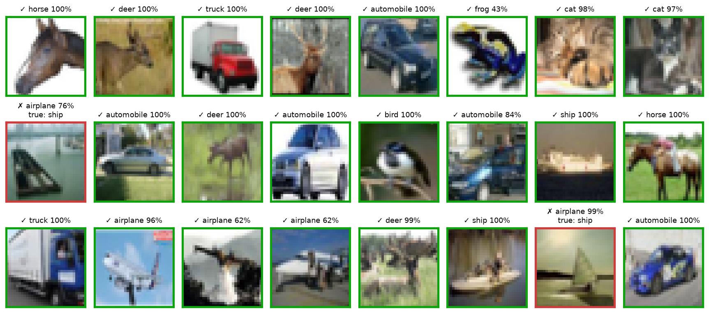
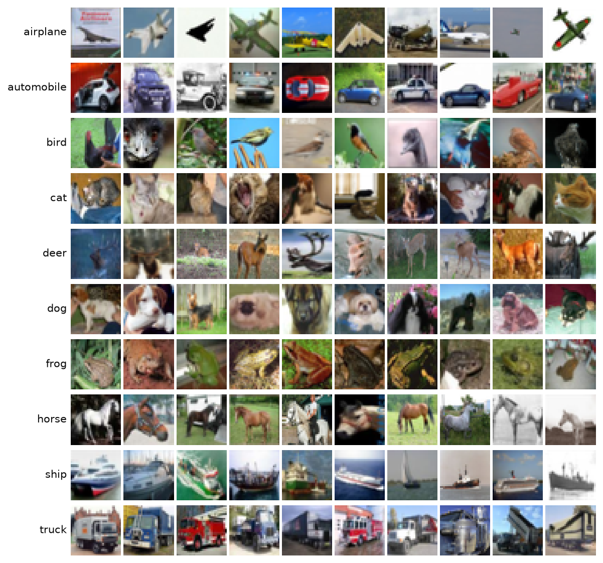
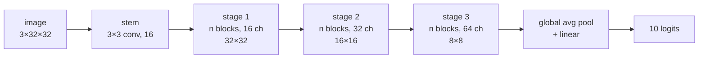
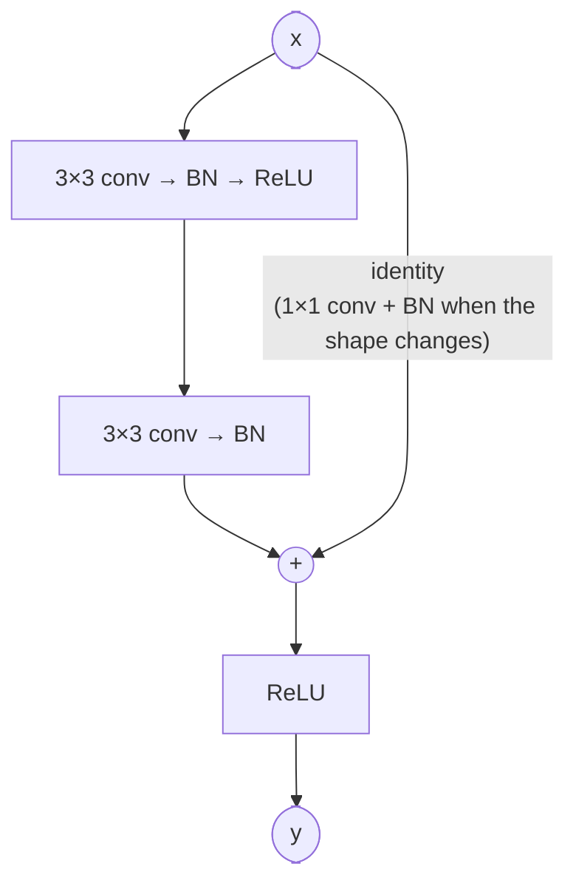
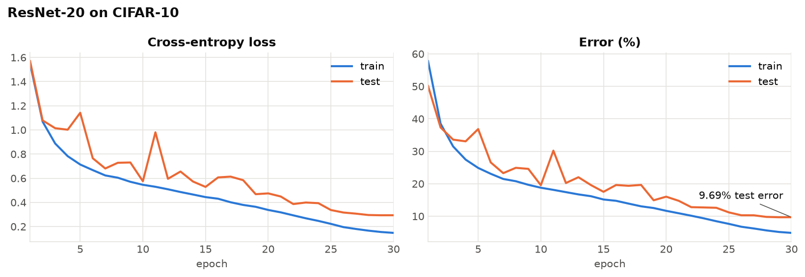
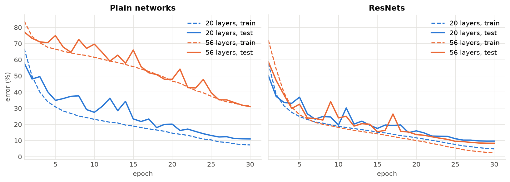
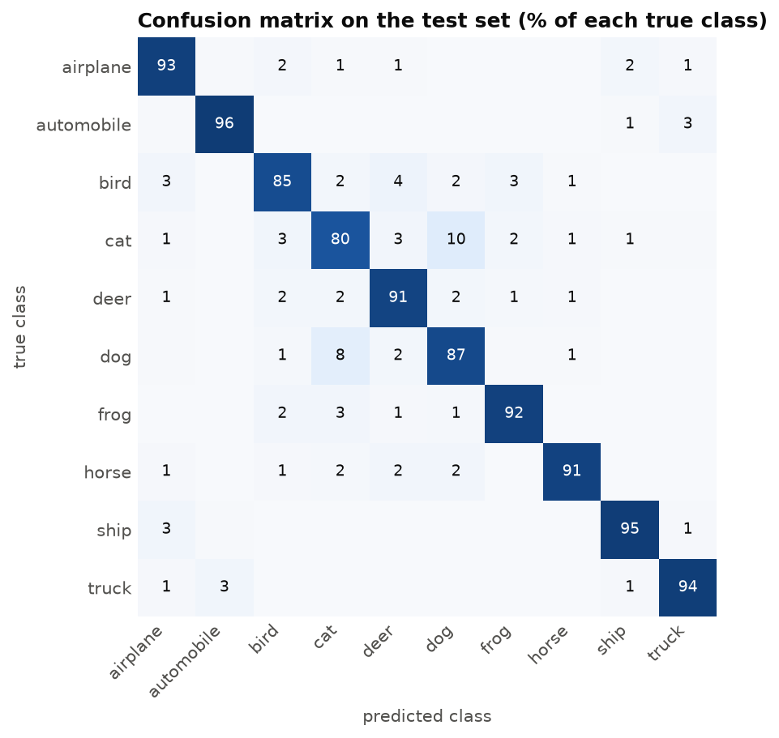

# ResNet on CIFAR-10

A from-scratch PyTorch implementation of the CIFAR-10 ResNets from
[*Deep Residual Learning for Image Recognition*](https://arxiv.org/abs/1512.03385) (He et al., 2015).
The model is about 100 lines and the training code is short enough to read in one sitting. The repo also
reproduces the paper's main experiment: deeper plain networks get *worse*, deeper ResNets get *better*.

[](https://github.com/sakuragi97/resnet-cifar10/actions/workflows/tests.yml)


| Model      | Layers | Params | Test accuracy | Paper (Table 6) |
|------------|-------:|-------:|--------------:|----------------:|
| ResNet-20  | 20     | 0.27M  | **90.31%**    | 91.25%          |
| ResNet-56  | 56     | 0.86M  | **91.65%**    | 93.03%          |
| Plain-20   | 20     | 0.27M  | 88.96%        | –               |
| Plain-56   | 56     | 0.85M  | 68.96%        | –               |

<sub>30 epochs with cosine decay (15 minutes for ResNet-20 on a laptop RTX 4060). The paper trains for
164 epochs, see <a href="#configuration">Configuration</a> to run that schedule.</sub>



## Contents

- [Why residual connections](#why-residual-connections)
- [The dataset](#the-dataset)
- [The model](#the-model)
- [Results](#results)
- [Quick start](#quick-start)
- [Configuration](#configuration)
- [Project layout](#project-layout)
- [Implementation notes](#implementation-notes)
- [References](#references)

## Why residual connections

Stacking more layers should never make a network worse: the extra layers could just learn the identity.
In practice it does. A 56-layer plain CNN has a higher *training* error than a 20-layer one, so this is an
optimization problem, not overfitting. He et al. call it the **degradation problem**.

ResNet fixes it by letting each block learn a correction to its input instead of a whole new mapping:

$$y = \mathrm{ReLU}\big(F(x) + x\big)$$

If the identity is the best a block can do, it only has to push $F(x)$ toward zero. The `+ x` also gives
gradients a direct path back to early layers, since $\partial y / \partial x = \partial F / \partial x + 1$.

## The dataset

[CIFAR-10](https://www.cs.toronto.edu/~kriz/cifar.html) has 60,000 color images of 32×32 pixels in 10
classes, split into 50,000 for training and 10,000 for testing. The classes are balanced (5,000 training and
1,000 test images each). It is downloaded automatically into `data/` on first run (about 170 MB).



The images are tiny and often hard even for people: cats and dogs look alike at this resolution, and the
background often says more than the object (ships on water, planes in the sky).

**Preprocessing**, as in Section 4.2 of the paper:

| Step | Train | Test |
|---|:---:|:---:|
| Pad 4 px on each side, random 32×32 crop | ✓ | |
| Random horizontal flip | ✓ | |
| Normalize with the per-channel training mean and std | ✓ | ✓ |

## The model



Each stage stacks `n` basic blocks. The first block of stages 2 and 3 halves the resolution (stride 2) and
doubles the channels; there the shortcut becomes a 1×1 convolution so the shapes match for the addition
(option B in the paper).



A network with `n` blocks per stage has `6n + 2` weighted layers: 1 stem conv, 6n convs in the blocks and the
final linear layer.

| `n` | Model | Params (this repo) | Params (paper) |
|---:|---|---:|---:|
| 3 | ResNet-20 | 272,474 | 0.27M |
| 5 | ResNet-32 | 466,906 | 0.46M |
| 7 | ResNet-44 | 661,338 | 0.66M |
| 9 | ResNet-56 | 855,770 | 0.85M |
| 18 | ResNet-110 | 1,730,714 | 1.7M |

The parameter counts are checked in the test suite. Passing `residual=False` builds the plain counterpart:
the same layers without any shortcut.

## Results

### Training curves (ResNet-20)



### Plain vs. residual networks

The four models below are trained with the same recipe. Dashed lines are training error, solid lines are
test error.



| | 20 layers | 56 layers |
|---|---:|---:|
| Plain, training error | 7.32% | **31.68%** |
| ResNet, training error | 4.87% | **2.42%** |

Without shortcuts, going from 20 to 56 layers makes the network much *harder to train*: its training error
after 30 epochs is four times higher. That is the degradation problem, and it is not overfitting since the
deeper model is worse on the training set itself. With shortcuts the same depth increase helps: ResNet-56
reaches a lower training error and a higher test accuracy than ResNet-20. The gap between the plain nets is
larger than in the paper because 30 epochs is a short budget for a network that learns this slowly, but the
direction is the same as in its Fig. 6.

### Where ResNet-20 gets confused



Vehicles are the easy part (automobile 95.6%, ship 94.8%, truck 94.5%). Animals are harder, and almost a
fifth of all errors are just cats and dogs being swapped: 96 cats are labeled dog and 81 dogs are labeled
cat. The other frequent mistakes also make sense: birds read as deer or frogs (brown animal in green
surroundings), ships as airplanes (object on a flat blue background), trucks as cars.

| Class | Accuracy | | Class | Accuracy |
|---|---:|---|---|---:|
| automobile | 95.6% | | horse | 91.4% |
| ship | 94.8% | | deer | 90.6% |
| truck | 94.5% | | dog | 86.8% |
| airplane | 92.7% | | bird | 85.0% |
| frog | 91.8% | | cat | 79.9% |

## Quick start

The project uses [uv](https://docs.astral.sh/uv/). On Linux and Windows it installs the CUDA 12.8 build of
PyTorch, on macOS the default build (CPU / Apple GPU).

```bash
git clone https://github.com/sakuragi97/resnet-cifar10.git
cd resnet-cifar10
uv sync
```

<details>
<summary>Without uv</summary>

```bash
python -m venv .venv && source .venv/bin/activate   # Windows: .venv\Scripts\activate
pip install torch torchvision --index-url https://download.pytorch.org/whl/cu128   # or /cpu
pip install matplotlib pyyaml tqdm pytest
```

Then drop the `uv run` prefix from the commands below.
</details>

**Train**

```bash
uv run python -m resnet.train --config configs/resnet20.yaml
```

Each run writes to `runs/<name>/`: the resolved `config.yaml`, a `history.csv` with one row per epoch and the
final weights in `model.pt`.

**Evaluate**

```bash
uv run python -m resnet.evaluate runs/resnet20/model.pt
```

This prints the overall and per-class test accuracy and saves `metrics.json` next to the checkpoint.
Pretrained ResNet-20 weights are included, so you can skip training:

```bash
uv run python -m resnet.evaluate results/resnet20/model.pt
```

**Use the model in your own code**

```python
import torch
from resnet.model import ResNet
from resnet.utils import load_checkpoint

# a freshly initialized network, any depth of the form 6n + 2
resnet56 = ResNet(depth=56)

# the pretrained ResNet-20 shipped with this repo, in eval mode
resnet20, config = load_checkpoint("results/resnet20/model.pt")
logits = resnet20(torch.randn(8, 3, 32, 32))  # shape (8, 10)
```

**Reproduce the figures**

```bash
uv run python -m resnet.figures --checkpoint runs/resnet20/model.pt --runs runs --out assets
```

**Run the tests**

```bash
uv run pytest
```

## Configuration

A run is described by a small YAML file in `configs/`. Every field can be overridden from the command line:

```bash
uv run python -m resnet.train --config configs/resnet56.yaml --epochs 100 --lr 0.05 --name resnet56_long
uv run python -m resnet.train --config configs/resnet20.yaml --no-residual --name plain20_test
```

| Field | Default | Meaning |
|---|---|---|
| `depth` | 20 | 6n + 2 layers: 20, 32, 44, 56, 110, ... |
| `residual` | true | `false` builds the plain network |
| `zero_init_residual` | false | start each block as an identity (last BN scale = 0) |
| `epochs` | 30 | number of training epochs |
| `batch_size` | 128 | as in the paper |
| `lr` | 0.1 | initial learning rate (SGD, momentum 0.9) |
| `weight_decay` | 5e-4 | L2 penalty |
| `scheduler` | cosine | `cosine` or `multistep` |
| `milestones` | [] | epochs where `multistep` divides the lr by 10 |
| `num_workers` | 2 | data loading processes |
| `device` | auto | `cuda`, `mps` or `cpu` |

`configs/resnet20_paper.yaml` follows the original schedule: 164 epochs, lr divided by 10 at epochs 82 and
123 (32k and 48k iterations), weight decay 1e-4.

## Project layout

```
resnet-cifar10/
├── configs/              # one YAML file per experiment
├── resnet/
│   ├── model.py          # BasicBlock and ResNet
│   ├── data.py           # CIFAR-10 datasets, augmentation, loaders
│   ├── engine.py         # train_one_epoch / evaluate / predict
│   ├── config.py         # dataclass config, YAML + CLI overrides
│   ├── utils.py          # seeding, device, checkpoints
│   ├── train.py          # python -m resnet.train
│   ├── evaluate.py       # python -m resnet.evaluate
│   └── figures.py        # python -m resnet.figures
├── results/              # training logs of the runs above + pretrained ResNet-20
├── assets/               # figures used in this README
└── tests/                # shapes, parameter counts, identity property, config parsing
```

## Implementation notes

- **No conv biases.** Every convolution is followed by BatchNorm, which subtracts the mean and adds its own
  learned shift, so a bias would do nothing.
- **Projection shortcuts only where needed** (option B). The paper's Table 3 shows it is slightly better than
  zero-padding (option A) and almost as good as projecting every shortcut (option C), at a fraction of the
  extra parameters.
- **The stride sits in the first 3×3 conv** of a block, and the ReLU comes *after* the addition, so the
  shortcut path stays clean.
- **He (Kaiming) initialization** for the convolutions, BatchNorm scale 1 and shift 0. A block with a zeroed
  last BN scale outputs exactly `ReLU(x)`, which the tests check.
- **Short schedule.** 30 epochs with cosine decay and weight decay 5e-4 instead of the paper's 164 epochs with
  step decay and 1e-4. The stronger weight decay works better for short runs; the paper schedule is one flag
  away.
- **No model selection on the test set.** The reported number is the accuracy after the last epoch, not the
  best epoch.
- Layer names (`conv1`, `bn1`, `downsample`, ...) follow torchvision's ResNet, so the code reads familiar to
  anyone who knows that implementation.

## References

- K. He, X. Zhang, S. Ren, J. Sun. [Deep Residual Learning for Image Recognition](https://arxiv.org/abs/1512.03385). CVPR 2016.
- K. He, X. Zhang, S. Ren, J. Sun. [Identity Mappings in Deep Residual Networks](https://arxiv.org/abs/1603.05027). ECCV 2016.
- P. Goyal et al. [Accurate, Large Minibatch SGD: Training ImageNet in 1 Hour](https://arxiv.org/abs/1706.02677). 2017. (zero-init of the last BN in each block)
- A. Krizhevsky. [Learning Multiple Layers of Features from Tiny Images](https://www.cs.toronto.edu/~kriz/learning-features-2009-TR.pdf). 2009. (CIFAR-10)

## License

[MIT](LICENSE)
